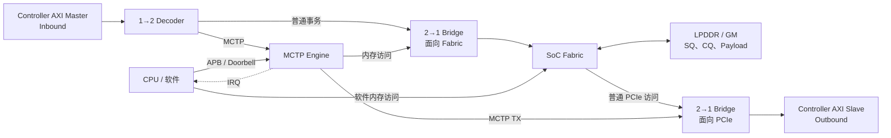
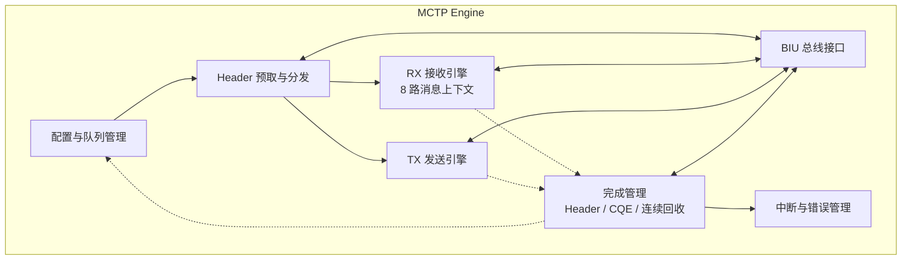
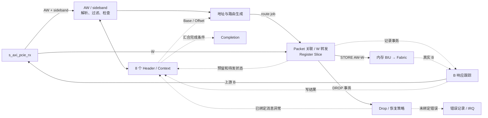
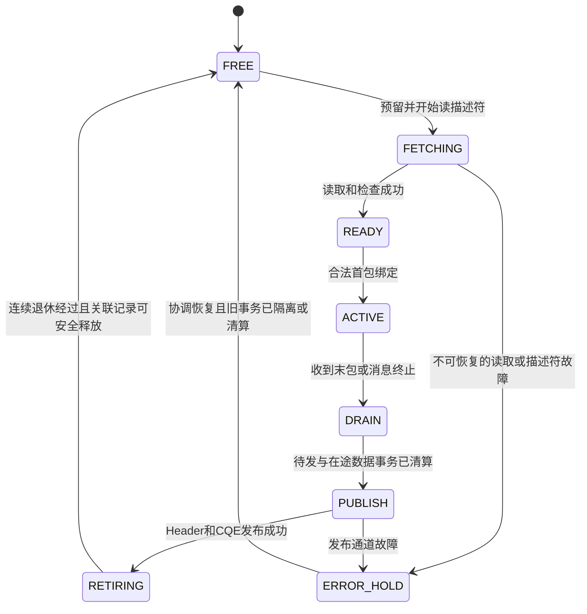
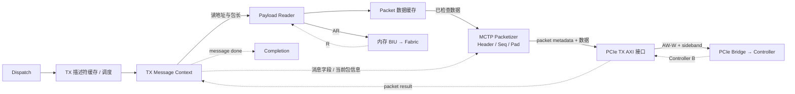
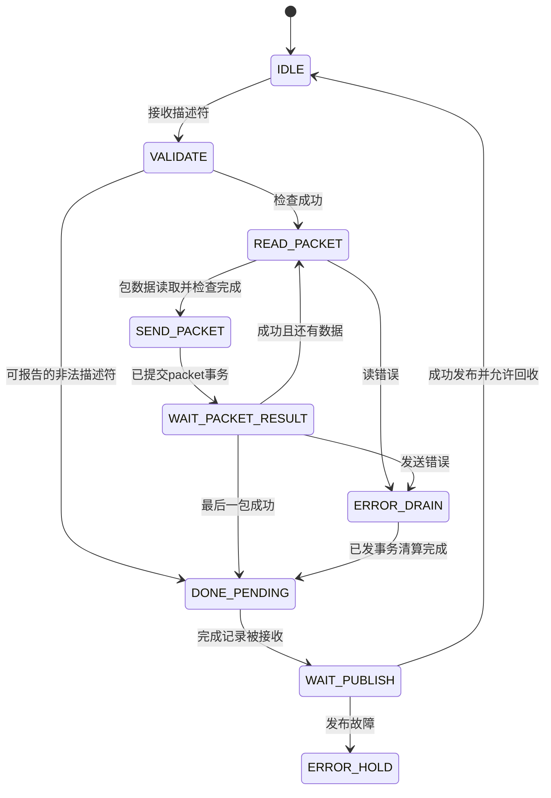
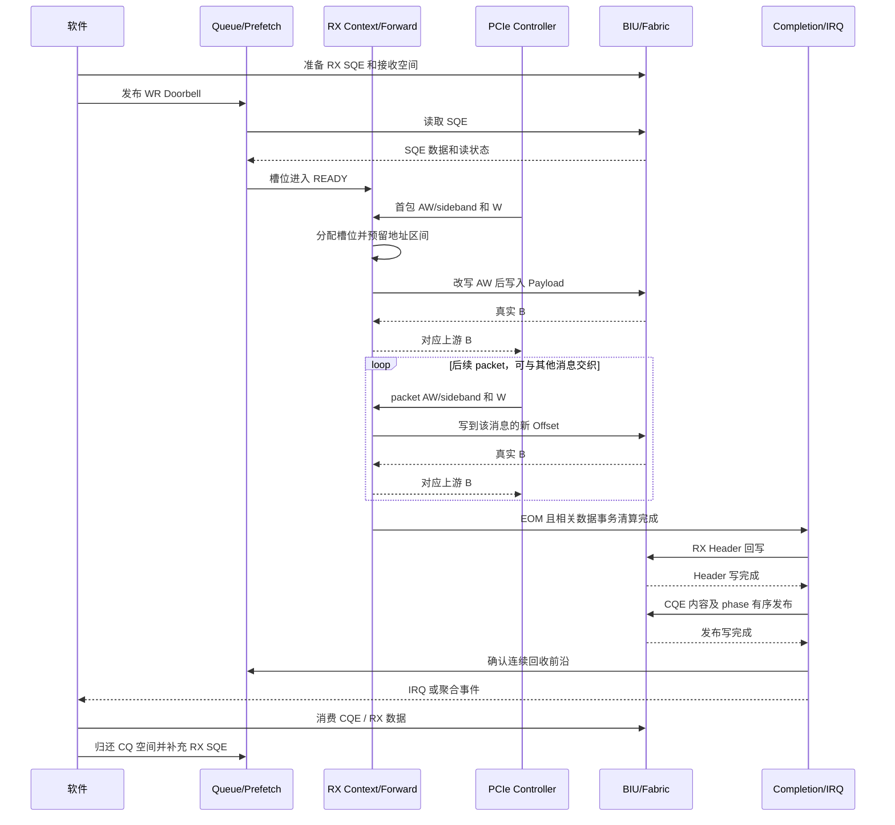
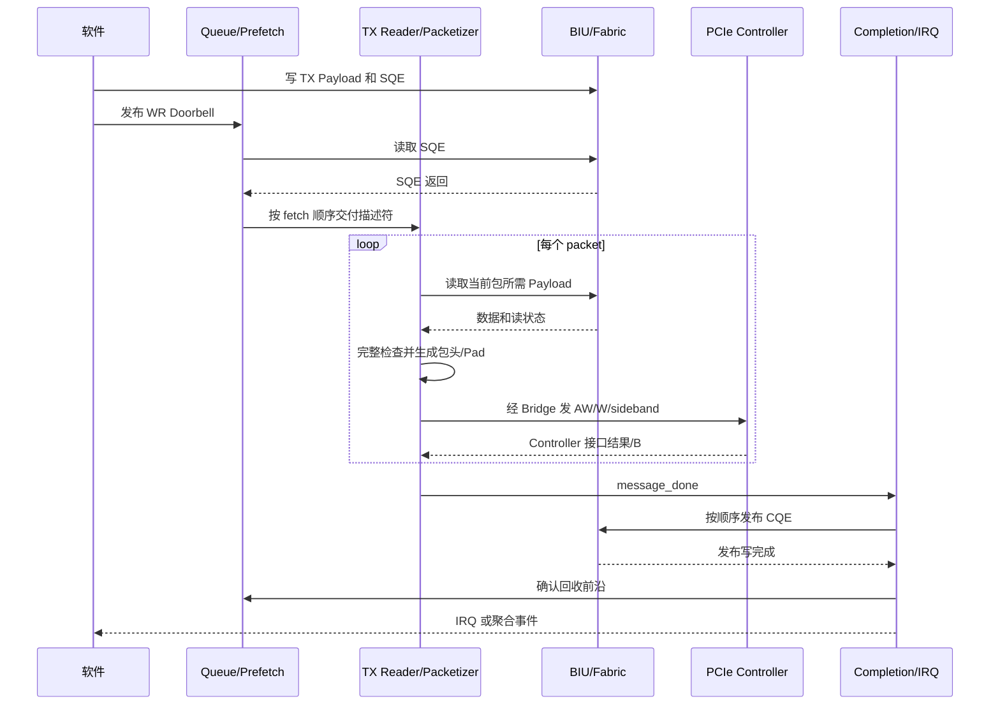

# MCTP Engine 架构规格说明书（AS）

| 项目 | 内容 |
| --- | --- |
| 文档类型 | Architecture Specification：系统架构、模块设计及接口行为 |
| 版本 | v0.1，架构评审草案 |
| 日期 | 2026-10-12 |
| 适用范围 | SQ/CQ 驱动的 MCTP over PCIe 收发引擎及其系统接入 |
| 当前阶段 | 架构设计；不宣称 RTL 已实现、性能已验证或软件 ABI 已冻结 |
| 主要输入 | 根目录六张需求图片、已有整理文档、当前对话中的架构讨论 |

## 目录

- [1. 文档约定与职责边界](#s01)
- [2. 需求基线与设计选择](#s02)
- [3. 整体架构与模块映射](#s03)
- [4. 外部接口与内部交互接口](#s04)
- [5. 数据结构和资源所有权](#s05)
- [6. 配置、队列、预取与分发](#s06)
- [7. Inbound / RX 模块设计](#s07)
- [8. Outbound / TX 模块设计](#s08)
- [9. BIU、Decoder 与 Bridge](#s09)
- [10. 完成、回收与中断](#s10)
- [11. 端到端交互数据流](#s11)
- [12. 异常、丢弃与超时](#s12)
- [13. 软件流程与寄存器规划](#s13)
- [14. 停机、复位、时钟与性能](#s14)
- [15. 验证与架构验收](#s15)
- [16. 待确认项](#s16)
- [17. 参考资料](#s17)

<a id="s01"></a>
## 1. 文档约定与职责边界

### 1.1 依据与优先级

1. **需求基线：**根目录 `1.jpg`～`6.jpg`，详见 [MCTP引擎需求整理.md](./MCTP引擎需求整理.md)。
2. **讨论形成的设计建议：**[MCTP系统架构设计.md](./MCTP系统架构设计.md) 及后续模块讨论。
3. **历史参考：**[MCTP补充资料分析.md](./MCTP补充资料分析.md)；`补充/` 是老版本，不自动继承其固定接收区、发送地址触发、512 B 包上限、128 KiB 消息上限、寄存器和黑洞地址实现。
4. 对协议约束使用第 17 节列出的明确版本进行核对，最终采用的规范版本仍须由项目确认。

本文的标记含义如下：

| 标记 | 含义 |
| --- | --- |
| REQ | 当前资料明确提出的需求 |
| CONTRACT | 对话确认或设计依赖的接口契约，接入当前 IP 时仍需核验 |
| DESIGN | 本稿推荐的可评审实现方案，不等于已批准的最终实现 |
| OPEN | 尚缺信息，列入第 16 节并说明影响；不以猜测填补 |

除 REQ / CONTRACT 和引用的协议约束外，下文的模块拆分、内部字段名、状态机、缓存组织及寄存器分组均属于 DESIGN。本文用于进一步划分 RTL 和验证职责，不规定未确认的端口位宽、寄存器地址或性能数值。

### 1.2 系统职责

| 参与方 | 职责 |
| --- | --- |
| 软件 | 组织上层消息，分配缓冲区，提交 SQE，消费 CQE，回收资源及处理错误 |
| MCTP Engine | 预取描述符、TX 分段和数据搬运、RX 消息匹配与数据放置、完成发布及中断 |
| PCIe Controller | PCIe 链路及 TLP 处理，通过其 AXI/sideband 契约接入 MCTP packet |
| SoC Fabric / 内存 | 为描述符、Payload、CQE 提供访问与返回，落实地址、属性和可见性约定 |
| Decoder / Bridge | 分类、仲裁、AW/W 关联、来源识别和响应返回；保持系统原有普通 PCIe 通路 |

本稿不增加上层 PLDM/SPDM 等协议解析、远端应用处理确认、自动重传或老版软件接口兼容功能。

### 1.3 术语和层级

| 术语 | 本文含义 |
| --- | --- |
| Message | 一条完整 MCTP 消息，是收发完成管理的单位 |
| Packet / Segment | Message 的一个传输分段；同一消息可有多个 packet |
| SQE / Header | 软件描述符，长度 32 B；与线上 packet header 分开编码 |
| CQE | 本地命令的执行结果，长度 16 B；不是远端 MCTP Response |
| RX Slot | 一份预取 Header 与接收上下文的内部资源 |
| AXI Transaction | 一笔读或写总线事务；其数量不等于消息数量 |
| Retire | 推进连续安全回收前沿，允许软件回收相应 SQ 条目 |
| Publish | 将完整、有效的完成记录发布给软件 |

TX/Outbound 和 RX/Inbound 表示本地传输方向，不分别限定为协议请求或响应。

<a id="s02"></a>
## 2. 需求基线与设计选择

### 2.1 需求追踪表

| 编号 | 类别 | 内容 | 主要落实位置 |
| --- | --- | --- | --- |
| R01 | REQ | SQ/CQ 在 LPDDR 或 GM，SQE 32 B、CQE 16 B | 第 5、6、10 节 |
| R02 | REQ | 多个 SQ 可以绑定同一个 CQ | 队列管理、Completion |
| R03 | REQ | 软件提交 WR Doorbell，硬件维护完成和回收位置 | 队列管理、软件流程 |
| R04 | REQ | TX 读 Header 和 Payload，根据包长约束分段并生成 SOM/EOM/Seq/Pad | TX Reader / Packetizer |
| R05 | REQ | TX CQE 按 SQE fetch 顺序返回 | TX 调度、Completion |
| R06 | REQ | RX 按 axmisc 分类，普通流量保留旁路 | Decoder |
| R07 | REQ | RX 支持 8 个 outstanding message 及不同消息 packet 交织 | RX 上下文管理 |
| R08 | REQ | 同一消息的分段顺序接收，检查 SOM/EOM/Seq | RX Pre Analysis |
| R09 | REQ | RX 无空闲 Header 时记录并中断 | 独立错误事件路径 |
| R10 | REQ | RX 可乱序完成，但 SQ_RD_PTR 只能连续推进 | Completion / Retire |
| R11 | REQ | 完整接收完成通知须等待相关写响应 | RX Track / Completion |
| R12 | REQ | EID 等过滤；4 组 mask 是原文候选配置 | Filter，O05 |
| R13 | REQ | 提供拥塞超时及丢弃，避免 MCTP 阻塞普通流量 | Timeout / Drop / 系统仲裁，O07 |
| R14 | REQ | Early response 可配置、默认 enable | 响应策略，O06 |
| R15 | REQ | 支持完成中断，可采用聚合 | Interrupt Control |
| R16 | CONTRACT | 当前 RX 讨论按一 packet 对应一笔 Controller 侧 AW 写事务 | RX 接口、O01 |

### 2.2 本稿推荐的初版方案

| 编号 | DESIGN 选择 | 目的与代价 |
| --- | --- | --- |
| D01 | TX/RX 独立 SQ 管理，共享一个物理 SQE reader | 复用内存读逻辑；调度需防止一方长期饥饿 |
| D02 | SQE reader 只保留一笔预取 AXI 读在途 | 简化返回分发；不限制整个 BIU 的其他读来源 |
| D03 | RX 用 8 个统一槽位，不另设额外 RX Header FIFO | 资源归属清晰；READY、收尾和待回收状态也会占槽 |
| D04 | RX 以 AW 地址改写和 W 流式转发为目标 | 无需仅因消息交织而配置整包缓存；需满足 O01/O03 |
| D05 | RX 乱序完成槽位保留到连续退休后释放 | 无额外退休窗口；前序慢消息会降低可用槽位数 |
| D06 | 初版串行执行一条 TX message；允许提前缓存描述符 | 易保持 fetch 顺序；吞吐受串行处理约束 |
| D07 | TX 提交一个 packet 前先完整读取并检查该包数据 | 读错误不会发生在已经承诺的发送包中途；需要包级缓存 |
| D08 | 初版 Completion 串行发布完成项并提交回收前沿 | 避免多个发布事务之间的前沿依赖；发布带宽需评估 |

D03/D05 是资源组织选择，不是协议对所有实现的限制。图上分别画出的两个 Prefetch、两个 CQ 管理块可以表示逻辑角色，不能据此推导出必须复制物理 reader 或禁止共享 CQ。

<a id="s03"></a>
## 3. 整体架构与模块映射

### 3.1 系统连接



箭头主要表示请求方向。R/B 沿请求的来源返回，不借用另一条收发通路。Controller AXI Master 是 RX 请求发起者；Engine 访问系统内存时是 AXI Master；向 Controller 发送 packet 时也是 AXI Master。

### 3.2 Engine 简化模块图



这是模块关系图，省略具体握手信号。BIU 可作为总线适配的统称；实现上区分 PCIe RX slave、内存 master、PCIe TX master 三部分。

### 3.3 原架构图到本稿的映射

| 图中名称 | 本稿的职责与说明 |
| --- | --- |
| Inbound / Outbound SQ | 内存 SQ 的管理与描述符缓存；图内队列不表示整个 SQ 都在片上 |
| Prefetch | 逻辑上服务两个方向，物理 reader 按 D01 共享 |
| Pre Analysis | RX AW/sideband 解析、过滤、消息查找、包序检查 |
| addr_mod | RX 地址计算、长度检查、packet 路由决定 |
| original address | 普通旁路已在外部 Decoder 分出；如内部保留此选择，须明确额外用途 |
| MCTP address | RX SQE 的 Payload 基址加该消息的预留偏移 |
| hole address | Drop 的候选实现，需真实可响应的系统 sink，尚未定案 |
| register slice | 通道寄存、反压和少量弹性缓存，不自动等于整包 FIFO |
| timeout | 监测指定阻塞条件并驱动错误/恢复；计时点尚未确认 |
| Payload Reader | TX 内存读请求、返回归属和有效数据整理 |
| MCTP generator | TX 分段、packet metadata 和 Controller sideband 生成 |
| CQ | 完成项生成、CQ 空间分配及发布控制；队列实体仍在内存 |
| Interrupt Control | 完成发布后的通知、错误通知和可选聚合 |

图上未单列的 RX AW/W 关联记录、B 跟踪、SQ 连续退休和 CQ credit 管理必须落实到对应模块。

<a id="s04"></a>
## 4. 外部接口与内部交互接口

### 4.1 外部逻辑接口

| 名称 | Engine 角色 | 请求及数据 | 返回及控制 |
| --- | --- | --- | --- |
| `s_axi_pcie_rx` | AXI slave | Controller 经 Decoder 输入 AW、sideband、W | B 返回 Controller，READY 用于反压 |
| `m_axi_mem` | AXI master | AR 读 SQE/TX Payload；AW/W 写 RX Payload/Header/CQE | R、B 来自 Fabric |
| `m_axi_pcie_tx` | AXI master | AW/W 和 sideband 发往 Controller slave | B 来自 Controller |
| `s_apb_cfg` | APB slave | 软件配置、Doorbell、状态访问 | APB 返回；具体版本和错误行为见 O10 |
| `irq` | 输出 | 完成或错误事件通知 | 数量、形式与清除方式见 O10 |
| `clk/reset` | 输入 | 时钟与复位 | 域划分与复位联动见 O11 |

这些是逻辑名字，不代表已冻结的 RTL 端口。AXI/APB 位宽、频率、ID 宽度、属性和未使用通道的处理均须由集成契约定义。

**AXI 共同约束：**通道独立握手；VALID 提出后保持信息直到握手；AXI4 W 按 AW 事务顺序关联；同 ID 的响应遵守顺序；burst 不跨 4 KiB。后续设计均以这些边界处理反压、仲裁和异常，参见 [Arm IHI0022H A3/A5/A6](https://developer.arm.com/-/media/Arm%20Developer%20Community/PDF/IHI0022H_amba_axi_protocol_spec.pdf)。

### 4.2 当前 Controller 需要提供的契约

| 方向 | 必须明确的内容 |
| --- | --- |
| RX 分类 | axmisc 中的 MCTP 标识、应放行的普通事务类型 |
| RX 包头 | EID、TO、TAG、SOM/EOM、Seq、路由等字段的位置及字节序 |
| RX 数据 | W 是否仅含 Payload、padding 位置、有效字节数来源、WSTRB 含义 |
| RX 事务 | 一包一 AW 的适用范围，AWSIZE/AWLEN、AWADDR 字节通道约定 |
| TX 包头 | sideband 编码、地址窗口或 bypass 等控制要求 |
| TX 大小 | MPS、TUZ、控制器内部限制如何换算为有效 packet payload 上限 |
| TX 返回 | AXI B 表示接收、排队还是更后的发送阶段；不得当作远端处理确认 |

老版 `*_awmisc_info` 等信号名可辅助核对，但不能直接作为当前 IP 的端口定义。

### 4.3 内部逻辑接口

下表是模块之间的事务契约，具体位宽另行参数化。除计数快照等旁带外，交接统一使用 valid/ready；握手前由发送方持有内容，握手后由接收方承担后续处理责任。

| 接口 | 生产者 → 消费者 | 主要信息 | 消费后的责任 |
| --- | --- | --- | --- |
| `fetch_req` | Queue → Prefetch | SQID、SQ 序号、SQE 地址、方向、已预留目标 | 完成一次读取或报告失败 |
| `fetch_rsp` | Prefetch → Dispatch | 来源、目标 token、32 B 数据、读状态 | 检查描述符并分发；错误不作为有效 Header |
| `rx_desc` | Dispatch → RX Slot | SQID/CID、SQ 序号、SQE 地址、Payload 指针 | 将预留槽位转为 READY |
| `tx_desc` | Dispatch → TX | 描述符、SQ 序号、TX fetch 顺序号 | 按序执行并保留最终结果 |
| `rx_packet_meta` | RX 接口 → Parser | 上游 AW 属性、sideband、内部 packet token | 形成一次处理决定 |
| `rx_route` | Parser/Context → Forward | STORE/DROP、slot token、目标地址、有效长度、AW 属性 | 关联对应 W，登记返回责任 |
| `mem_rd_req/rsp` | Prefetch/TX ↔ BIU | 来源、token、地址、长度 / 数据、有效字节、状态、末拍 | 正确返回到请求方 |
| `mem_wr_req/data/rsp` | RX/Completion ↔ BIU | 类别、token、地址、长度、数据 / 写状态 | 请求、数据、响应始终关联 |
| `tx_packet` | Packetizer → TX 接口 | packet 元数据、数据流、有效字节、packet 末拍 | 生成合法 Controller 事务 |
| `tx_packet_result` | TX 接口 → TX Context | packet token、执行状态 | 更新当前 message 发送状态 |
| `message_done` | RX/TX → Completion | SQID/CID、SQ 序号、slot/message token、结果、RX 回写信息 | 接管有界的待发布记录 |
| `publish_ack` | Completion → RX/TX | 对应 token、发布结果 | 成功时进入待退休；失败保持可恢复状态 |
| `retire_update` | Completion → Queue/Slot | SQID、新连续前沿、可释放集合 | 原子提交回收状态 |
| `error_event` | 各模块 → Error/IRQ | 来源、原因、可用关联信息、地址等 | 留存错误，避免依赖失败的 CQ 路径 |

内部 token 区分 SQ 序号、slot/packet 生命周期与事务类别，不只依赖 CID。`read_last`、`packet_last`、`message_eom` 必须分开定义，禁止共用一个未说明含义的 `last`。

<a id="s05"></a>
## 5. 数据结构和资源所有权

### 5.1 软件可见结构

| 对象 | 既定内容 | 尚未冻结的内容 |
| --- | --- | --- |
| SQE | 32 B；CID、LEN、PAYLOAD_PTR、OPCODE 及报文字段 | 部分位域/映射歧义，见 O02 |
| RX SQE | CID、PAYLOAD_PTR、OPCODE 由软件提供；接收信息与实际 LEN 由 Engine 回写 | 接收容量的输入机制，见 O04 |
| TX SQE | 软件提供 Header 信息和 Payload 地址/长度 | 最大合法长度、初始 Seq 等配置约定 |
| CQE | 16 B；PHASE、STATUS、CID、SQID、SQ_RD_PTR、Command specific | 错误码、特定结果、指针编码及 phase 发布契约 |

完整转录位域见 [需求整理的 SQE/CQE 表](./MCTP引擎需求整理.md)。其中 `PAYLOAD_PTR` 标为 64 bit、位置却为 `192:128`；本稿不悄然修正为另一范围。SOM/EOM、VDM_CODE、MSG_CODE 的描述符到线上映射同样需要明确。

TX `LEN` 的有效字节数按当前定义为 `LEN + 1`。计算前需扩展位宽，避免最大编码加一溢出。该字段的表达范围不等于硬件承诺支持的最大消息长度。RX `LEN` 是结果，不能直接当作软件输入的 buffer capacity。

### 5.2 队列地址与序号

```text
sqe_addr = sq_base + physical_sq_index * 32
cqe_addr = cq_base + physical_cq_index * 16
```

地址加法需检查范围，基址配置需符合最终对齐契约。建议内部使用带回绕代次的逻辑序号；物理下标由深度映射。WR、FETCH、RD 的比较不得直接使用无代次的环形下标。

### 5.3 RX 上下文建议字段

| 字段组 | 内容 |
| --- | --- |
| 生命周期 | occupied、state、内部生命周期 token、message_match_valid |
| 软件关联 | SQID、CID、SQ 序号、SQE 地址 |
| 消息键 | 接收域、本地端点作用域、SEID、TO、TAG |
| 存储 | Payload Base、预留偏移、实际有效字节数、可用容量或容量策略引用 |
| 协议 | 期望 Seq、首包信息、EOM/终止标记、必要的 Header 回写字段 |
| 总线 | 待发 job 数、未完成 W 状态、等待真实 B 数、错误锁存 |
| 完成 | done 已移交、Header/CQE 发布阶段、是否允许连续退休 |

slot 占用与消息键可匹配状态分开管理：READY 占资源但尚无活动消息；旧消息完成后的记录也不能阻止正常的新消息键重用。具体重复 SOM/资源不足策略见 O08。

### 5.4 所有权与不变量

1. 软件发布 SQE 前完成描述符和 TX 数据准备；发布后不修改或复用仍由硬件持有的区域。
2. 预取只复制 Header，不表示 SQE 已执行完成，也不允许软件立即回收。
3. 每个 RX 预留槽位只能对应一个描述符生命周期；每个 packet 只能有一次路由提交。
4. CQE 成功发布后完成项占用的 CQ 空间仍归软件消费流程管理；只有软件消费归还 credit。
5. RX buffer 的软件消费/重新提交与 SQE 连续退休分别遵守约定；本稿采用保守流程，不以 packet EOM 提前回收。
6. 资源满时反压或进入已定义的错误/丢弃路径，不覆盖有效条目。
7. 复用内存前必须保证旧写事务不会再写入；仅添加内部代次不能阻止旧事务污染内存。

<a id="s06"></a>
## 6. 配置、队列、预取与分发

### 6.1 配置与 Doorbell 模块

**功能：**接收 APB 访问，保存队列、过滤、收发使能、异常和中断配置，将 Doorbell 转成队列管理事件。

**内部组织：**配置寄存器、运行状态寄存器、Doorbell 更新逻辑、错误状态及清除逻辑。建议影响地址和协议解释的配置只在队列停用且相关活动清算后生效；普通中断 mask 可独立更新。

**交互：**APB 写提交成功产生一次配置事件；Queue Manager 是运行时队列指针的唯一状态所有者。跨时钟域时传递完整更新事件，不把多 bit Doorbell 各自做两级同步。

**异常：**非法深度/绑定、越过允许提交窗口的 Doorbell、活动中修改关键配置均需定义明确返回或状态。具体编码不在本稿虚构，见 O09/O10。

### 6.2 SQ 管理模块

TX 与 RX 分别维护配置和 WR/FETCH/RD 状态，生成 `fetch_req`。建议对多 SQ 使用轮询或带资源约束的公平调度；没有对应接收资源的 RX SQ 不占用物理 reader。

预取资格至少满足：

```text
queue_enabled
AND FETCH 尚未到达软件已提交的 WR
AND 目标描述符缓存/槽位可预留
AND 没有阻止该队列继续执行的错误
```

本稿将 FETCH 定义为已预留读取范围的末端；预留握手时同时推进 FETCH 并建立请求记录。若读取失败，保留失败位置和归属，按恢复策略处理，不把它偷偷跳过。重复写相同 Doorbell 不重复生成已预留请求。

TX 的统一 fetch 顺序号在预取预留时分配，读取失败或描述符非法的位置同样占用顺序号。可识别 CID 的错误完成也进入相同顺序约束；不可可靠读取的前序项阻止后续 TX 发布，直到恢复流程明确处理该位置。初版同时暂停其后 TX 执行，RX 可在自身资源和共享接口允许时继续；不能只停一条 TX SQ 却让其他 TX SQ 的后序 CQE 越过故障位置。

软件可能先看到有效 CQ phase，再提交依赖新 RD 的 WR，而 Completion 尚未收到最终发布写的 B。Queue Manager 因此要接收 Completion 登记的候选前沿，允许暂存范围合法的提前 Doorbell；在发布确认前，不激活依赖该前沿的新预取。具体原子提交关系见 10.2/10.4。

RX 选择哪个 SQ 的 READY 描述符接收新消息，需要明确多队列映射策略。第一版可按配置的接收队列或公平选择可用队列，但不得自行推断“每个 SEID 固定一条 SQ”，见 O09。

### 6.3 共享 Prefetch

**输入：**带目标预留 token 的 `fetch_req`。**输出：**BIU 读请求和带来源的 `fetch_rsp`。

建议状态流程：

```text
IDLE → ISSUE_AR → RECEIVE_R → DISPATCH_RESULT → IDLE
```

ISSUE_AR 前锁存 SQID、起始 SQ 序号、数量、目标槽位/缓存位置。R 返回按 byte/beat 累积完整 SQE，并保留读错误。完整结果被 Dispatch 接收后释放 reader 的请求状态。

第一版只允许一笔预取读在途。一次读取多个 SQE 是优化选项，必须同时满足目标空间已全部预留、不读越 WR、环形边界和 AXI 边界合法；不能将原文“一次取 4 个”作为固定要求。

**错误处理：**读失败的 SQE 不进入 READY/TX 有效队列。若 CID 未可靠取得，以 SQID、SQ 序号和地址记录故障并停住受影响队列；不伪造普通 CID 完成。是否允许软件触发重新读取由 O13 定义。

### 6.4 Command Dispatch

检查读状态、来源 SQ、OPCODE、长度/地址及可检查字段，再分发给 RX 或 TX。来源为 RX SQ 但 OPCODE 为 TX 等不一致视为描述符错误，不静默改投另一方向。

Dispatch 的交接是 Header 所有权转移点：成功写入 RX 预留槽位后置 READY；成功写入 TX 缓存后进入可调度状态。返回方被反压时保留完整内容，不重复入队。

对可识别 CID 的非法命令，建议进入错误完成流程；对描述符不可可靠读取的故障，使用队列错误路径。两类出口均需保持 SQ 前沿可追踪。

<a id="s07"></a>
## 7. Inbound / RX 模块设计

### 7.1 连接图



预取模块向 CTX 写入 RX Header；图中省略其连线。RX 不缓存完整 message，Payload 直接组织到描述符指定的内存区域。

### 7.2 RX 接口与 AW Metadata 接收

**功能：**接收 Decoder 分出的 MCTP AW/sideband，保留与 W 及 B 的关联；对不支持的请求类型按当前 IP 契约处理。

**设计方法：**设置有界的 packet metadata/route 记录队列。仅在有能力保存已接受事务时给出 AWREADY；下游提交前还必须有响应跟踪资源。AW 与 W 可以独立到达，W 暂无可用路由时反压，或使用已计入容量的少量弹性缓存。

接受 AW、解析完成、下游 AW 提交是三个不同事件。不能以 AWVALID 连续为高当作多次接受，也不能以 W 的到达推断其消息归属。每个已接受的 AW 最终必须得到恰好一次上游响应，或进入明确的系统复位恢复边界。

### 7.3 Pre Analysis 与 Filter

**输入：**AW metadata 和 sideband。**输出：**解析字段、检查结果和 packet 的处理决定。

建议处理顺序为：识别受支持报文 → 执行过滤 → 消息查找/新消息资源检查 → SOM/EOM/Seq 检查 → 地址和长度检查 → 提交路由决定。被过滤的新消息原则上不消耗 RX READY 描述符。

过滤拒收路径也需要检查是否关联已经绑定的 ACTIVE 消息。本稿建议：未绑定时直接走无上下文 Drop；命中活动消息时生成终止事件，保留并清算旧事务，避免拒收末包后槽位永久停留在 ACTIVE。初版不默认允许活动消息期间热更新 Filter；若后续允许，应在 O05/O08 明确按消息冻结规则版本或采用上述关联终止策略。

Filter 可设计为 value/mask 表加动作配置；例如候选匹配形式 `(input & mask) == (value & mask)`。这只是消除原文表达歧义的建议，匹配后放行还是丢弃、规则优先级、无匹配默认动作以及规则数量由 O05 确认。

元数据解析不让 W 穿过 Header 解析器。解析输出的 packet token 将决定与后续 W 关联；sideband 字节序在本模块转成内部字段表示。

### 7.4 消息查找与上下文管理

RX 8 个槽位可用寄存器组和并行比较实现，匹配逻辑规模较小。选择 SRAM 或多拍查询也可，但需增加命中/更新间的互锁，避免同一消息的连续 packet 看到旧 Offset/Seq。

本稿使用“本地接收作用域 + SEID + TO + TAG”作为消息键。正常消息的首包建立状态，后续包按键查找并验证包序；协议消息标识及组装规则参见 [DSP0236 v1.3.3 第 8 节](https://www.dmtf.org/sites/default/files/standards/documents/DSP0236_1.3.3.pdf)。

| 收包情况 | 上下文动作 | 后续处理 |
| --- | --- | --- |
| 合法新 SOM，存在 READY 描述符 | READY → ACTIVE，绑定键和初始状态 | 接收首包 |
| 合法后续包，命中 ACTIVE | 检查 Seq，预留本包区间 | 接收并更新状态 |
| SOM=EOM=1 的单包消息 | 新建并立即标记输入结束 | 仍等待 W/B 完成 |
| 无 READY 描述符 | 不虚构 slot/CID | 独立记录错误并丢弃，后续包策略见 O08 |
| 无活动匹配且非 SOM | 不创建正常接收上下文 | 异常丢弃/记录 |
| 序号错误或越界 | 标记对应消息异常，停止新增有效写 | 清算已有事务，再执行错误完成策略 |
| ACTIVE 中遇到同键新 SOM | 不覆盖旧上下文 | 旧消息终止与新消息起始须分别处理，见 O08 |
| 旧消息已结束，同键新 SOM | 将其识别为新消息候选 | 是否有 READY 资源决定接收；不能把旧 RETIRING 记录当活动命中 |

DSP0236 v1.3.3 对重组期间同键新 SOM 描述了终止旧消息并开始新消息的行为。当前需落实新描述符、旧写清算和资源不足时的边界，不能照搬老版本“直接丢新包直到软件 clear”的策略并声称符合该规范。[DSP0236 §8.9](https://www.dmtf.org/sites/default/files/standards/documents/DSP0236_1.3.3.pdf)

### 7.5 RX Slot 状态机



FREE 之外均占用资源，所有状态计数之和恒为 8。可识别且允许错误完成的描述符故障也可进入相应错误发布流程；图中 ERROR_HOLD 表示不能直接正常发布或释放的故障。

多个事件同周期出现时统一计算 next-state，例如新 job 进入、下游 AW 接受、W 末拍、B 返回。完成判定使用合并后的状态，不能因先减计数再加计数的实现顺序提前完成。同周期释放的 slot 第一版可到下一周期才对新 SOM 可见，降低组合依赖；无资源判断与该规则一致。

### 7.6 地址计算与长度管理

对于 STORE 路径：

```text
packet_addr = payload_base + reserved_offset
next_offset = reserved_offset + packet_valid_payload_bytes
```

在 packet 路由提交时原子记录目标地址并推进 Offset/Seq/EOM 状态。该提交事件仅发生一次；不能等真实 B 返回才分配下一包地址。实际累计的是有效 Payload 字节，不把 Header 或 pad 无条件计入消息长度。

发出目标写请求前检查：地址加法溢出、长度累加溢出、消息容量、有效写字节范围、字节通道/WSTRB 兼容以及 burst 边界。即使 pad 不计入消息长度，其实际被写入的字节仍不能越过分配范围。

**O03/O04 尚未冻结：**当前 PAYLOAD_PTR 只要求 4 B 对齐，不能保证所有 AW 改址都能 W 原样转发；RX LEN 是输出，也不能充当接收容量输入。必须选择可检查的地址/容量契约，或增加字节重排/事务拆分适配。若引入拆分，一笔上游写可能产生多笔下游写，需扩展 B 汇聚和错误合并；本稿不假定已具备该能力。

### 7.7 Packet 关联、W 转发与 Register Slice

每个 packet job 保留上游 AW 信息、处理动作、目标地址、slot token、预期 beat 数及响应责任。W 调度使用最前面的对应 job，转发到该 job 的目的端，直到整笔事务数据结束。

STORE 尽量保留 WDATA，只在明确契约要求时调整 WSTRB/字节排列。Register Slice 缓解时序和反压，不需要为了 8 路消息交织就存放 8 个完整 packet。

内部 Payload 写与 Header/CQE 写共享 BIU 时，先选择来源，再保证该来源的 AW 和对应 W 不被另一来源错误拼接。每个通道保持自身握手独立，不能通过等待 READY 才产生 VALID 的循环依赖造成死锁。

### 7.8 RX 写事务与 B 跟踪

**记录单位是 AXI 事务，不是 message。**记录至少含来源类别、上游 ID、下游 ID/映射 token、同 ID 内序号、所属 slot、W 状态、下游 B 状态、上游响应状态。

正常 STORE 的真实 B 来自 Fabric。BIU 路由到 RX Track 后，一路作为原始事务响应返回 Controller，一路更新所属消息的写结果。Header/CQE 的 B 路由到 Completion，不返回 Controller 的 RX master。

建议按每 slot 维护以下逻辑状态，具体计数器可以合并但含义必须可区分：

```text
pending_jobs   = 已提交路由、尚未交给下游AW或本地终止端的 packet 工作
pending_w      = 已预记且尚未完成 W 处理的 packet 数，包括 W 尚未到达的包
pending_b      = 下游已接受 AW 但真实 B 尚未由跟踪器接收的写事务
```

各候选路径的计数事件如下，表中的 slot 计数只适用于已绑定消息；未绑定 Drop 使用独立有界的 packet/响应记录。

| 路径/事件 | pending_jobs | pending_w | pending_b |
| --- | --- | --- | --- |
| 绑定消息的 route job 被 Forward 接受 | +1 | +1，即使 W 尚未到达 | 不变 |
| STORE 或 Fabric sink 的下游 AW 握手 | -1 | 不变 | +1 |
| STORE 或 Fabric sink 的下游最后 W 握手 | 不变 | -1 | 不变 |
| 对应真实 B 被跟踪器接收 | 不变 | 不变 | -1 |
| 若选本地 Drop：最后 W 被本地消费 | 等待终止记录接管 | -1 | 不增加 |
| 若选本地 Drop：一次上游响应责任已交给终止/响应记录 | -1，须在本地 W 消费完后 | 不变 | 不增加 |

一笔 job 改走尚未提交的 Drop 路径时沿用原计数，不重复加一；已向下游提出 VALID 后不能再靠换路由撤销原责任。同周期加减合并计算。仍拉高 AWVALID 等待接受的请求由 pending_jobs 覆盖，等待 W 的已提交请求由 pending_w 覆盖。

若真实 B 先被内部响应 FIFO 接收，而上游 B 尚未握手，该 FIFO/事务记录必须继续保存恢复原始响应所需信息。slot 释放不得破坏未完成的上游响应；可以等待返回清算，或把全部所需状态转交给独立记录，不能只清掉 slot。

RX 正常执行结束条件为 `EOM_seen && pending_jobs==0 && pending_w==0 && pending_b==0 && no_error`。异常消息使用 terminal_error 结束输入，但仍要清算相关事务后才能发布错误结果。

### 7.9 Drop 和 Timeout 的连接

Drop 接收路由决定和被丢弃 packet 的总线责任；已绑定异常更新对应 context，未绑定异常直接写 Error/IRQ。Timeout 输出“原因、对象、发生阶段”，驱动相同的恢复路径，不绕过写事务跟踪。

具体 Drop 终止端和超时点见第 12 节。RX 的正常 STORE 路径不额外生成一笔与 Fabric B 重复的本地 B。

<a id="s08"></a>
## 8. Outbound / TX 模块设计

### 8.1 连接图



### 8.2 描述符缓存与 TX Context

TX 描述符缓存接收 `tx_desc`，保存 SQID/CID、SQ 序号、fetch 顺序号、Payload 地址/长度及报文字段。缓存满时停止分发和对应预取预留。

初版按 D06 同时执行一条 TX message。多个 TX SQ 的严格顺序作用域尚未完全明确；为保守满足 R05，本稿使用在 TX 预取预留时分配的统一 fetch 顺序号串行处理，包括第 6.2 节规定的错误位置，待 O15 确认后再决定是否可放宽成各 SQ 内有序。

TX Context 保留：当前描述符、总有效字节数、已处理 Offset、剩余字节、当前 packet 序号、包内读取进度、发送状态及错误锁存。消息结果被 Completion 接收之前不得被下一条描述符覆盖。

建议初版状态流程：



这是易实现的串行建议，不是吞吐最优实现。后续可重叠下一包读取与当前包发送，但需增加缓存、事务记录和可验证的顺序控制。

### 8.3 Payload Reader

**输入：**当前消息的内存地址、待读有效字节数及 packet 目标大小。**输出：**BIU 读请求和带有效字节信息的数据，写入 Packet Buffer。

Reader 将内存访问分解为合法 burst，受内存总线宽度、地址边界和缓存剩余容量约束。一包 Payload 可以通过多个 AR 读取，不能把一笔内存读 burst 等同于一个 PCIe packet。

每笔读保留来源 token、期望返回长度和写入缓存位置。R 返回检查状态、有效字节数和末拍。允许多个读在途时，必须处理返回归属与数据重排；初版读 outstanding 深度由 O12 评估，不能被“SQE reader 一笔在途”隐式限定。

读错误时停止为该消息提交新的 packet，保留并清算已发读事务。已经发出 AR 的读，即使数据不再有用，也必须能接收其剩余返回，或进入明确的系统恢复流程。

### 8.4 Packet Buffer 与 MCTP Generator

推荐初版在发送前完整收集并检查一包 Payload。缓存容量由最终允许的 packet payload/pad 决定，不写死为老版 512 B，也不存储整个 message。

Packetizer 使用内部消息字段和当前 packet 位置生成 SOM/EOM、Seq、长度及 padding。单包消息同时标记 SOM/EOM；普通多包消息首包、末包分别设置对应标记，中间包保持分段状态。Seq 按采用的 MCTP 规范推进，初始值策略见 O15。

定义 `P` 为经过 Controller/TUZ/MPS 契约确认的有效 packet payload 上限后，单包有效字节数可写为 `min(remaining_bytes, P)`。P 不能直接未经换算就等同 PCIe MPS；头部开销、TUZ、pad 的单位和生成责任见 O01。报文及 padding 布局核对 [DSP0238 v1.2.1](https://www.dmtf.org/sites/default/files/standards/documents/DSP0238_1.2.1.pdf)。

SQE 解码值逐字段映射到 Controller sideband，特别处理 VDM_CODE、MSG_CODE、SOM/EOM 位布局及字节序差异。发送到 Controller 的 AWADDR 属于其接口契约，不默认等于 Payload 的内存地址。

选择流式 TX 作为优化时，必须先解决“AW 已承诺完整长度，后续内存读失败”的恢复问题，不能在 packet 中途直接停止 W。

### 8.5 PCIe TX 接口与发送完成

TX 接口接收完整 packet 元数据和可供发送的数据，生成 Controller 要求的 AW/W/sideband。记录 packet token 与总线 ID，依据实际握手发送 WSTRB/WLAST，并把 Controller B 归还所属 TX Context。

初版按上述状态机等待当前 packet 的结果，再处理下一包。更深的 packet outstanding 是后续性能选择；若启用，需保留每笔在途记录并按结果汇合消息状态。

成功 message_done 要求：有效 Payload 全部处理、所有 packet 已提交、无尚未传递的数据、所有相关 Controller 接口完成条件满足、无错误。Controller B 的含义由 O01 核定；它不表示远端 MCTP 应用已成功消费消息。

部分 packet 已发送后发生错误，报告本地失败并清算在途事务；不默认自动重发整条消息，避免产生重复消息或副作用。是否提供重试由软件和协议策略另行决定。

<a id="s09"></a>
## 9. BIU、Decoder 与 Bridge

### 9.1 内存侧 BIU

建议内部包括读请求仲裁、读返回分发、写请求/数据仲裁、写返回分发、来源/ID 映射和有界响应缓存。

| 来源 | 访问类别 | 返回消费者 |
| --- | --- | --- |
| Prefetch | SQE AR/R | Prefetch / Dispatch |
| TX Payload Reader | Payload AR/R | TX Reader |
| RX Forward | Payload AW/W/B | RX B Tracker，并返回上游 |
| Completion | RX Header AW/W/B | Completion |
| Completion | CQE AW/W/B | Completion |

同一个接口的所有读/写 outstanding 都有显式容量限制。仲裁仅选择能够保留请求及返回记录的来源；不能在没有返回空间时无限接受请求。

建议使用来源类别和内部 token 建立关联。若实际 AXI ID 宽度足够，可通过 ID 编码部分来源；否则使用映射表。即使 ID 已编码来源，同 ID 多笔事务仍需顺序关联。来源识别与外部原始 ID 恢复是两个责任。

读与写调度可独立进行；同一 Completion 链上的数据依赖由 Completion 控制，而非依赖不同 ID 请求的偶然顺序。写侧对完整 burst 维持来源关联，不能按 W beat 任意切换来源。

### 9.2 Inbound Decoder

Decoder 对普通事务和 MCTP 事务分类，保存 AW 路由并将 W/B 关联到正确路径。普通读事务若在其接口范围内，同样遵循正常 AR/R 路由，不进入只处理 MCTP 写的 RX 状态机。

两条路径的 AXI ID 顺序责任必须在 Decoder/Bridge 组合中闭合；不能因应用层说“两种流量没有 ordering”而破坏总线接口的同 ID 返回规则。

### 9.3 两个 Bridge

| Bridge | 两个输入来源 | 输出目的端 | 必须保存的关联 |
| --- | --- | --- | --- |
| 面向 Fabric | 普通 Inbound 旁路、Engine 内存 master | Fabric slave 端口 | 来源、ID 映射、AW/W、R/B 返回 |
| 面向 PCIe | Fabric 普通 Outbound、Engine TX master | Controller slave | 来源、AW 与 sideband、W、B 返回 |

建议在 burst 级保持数据关联，并采用有界、公平的事务选择。不可让 Engine 跨整条多包 message 独占 Bridge。具体仲裁权重、允许的占用时间及吞吐目标见 O12。

外部 Decoder 的普通旁路减少了进入 RX 处理的依赖，但共享 W 顺序、Bridge 或 Fabric 仍可能传播阻塞。因此“普通流量不受 MCTP 长期阻塞”必须通过系统级进展分析和验证落实，不能只凭旁路存在就宣称已经满足。

### 9.4 各类响应的归属

| 请求类型 | 真实响应来源 | 最终去向 |
| --- | --- | --- |
| 普通 Inbound 写 | Fabric | 经 Fabric Bridge、Decoder 返回 Controller master |
| MCTP RX Payload 写 | Fabric | 经 BIU/RX Track、Decoder 返回 Controller master，并更新消息状态 |
| Header/CQE 写 | Fabric | Completion 内部消费 |
| SQE/TX Payload 读 | Fabric | Prefetch 或 TX Reader |
| MCTP TX 写 | Controller slave | TX 接口与 TX Context |
| 普通 Outbound | Controller slave | 经 PCIe Bridge 返回 Fabric 原发起端 |
| DROP | 取决于终止方式 | 待 O16 定义，必须保留一次上游响应责任 |

<a id="s10"></a>
## 10. 完成、回收与中断

### 10.1 Completion Manager

Completion 接收已清算执行阶段的 `message_done`，负责 RX Header 回写、CQ 空间分配、CQE 构造、发布确认、SQ 连续退休和中断事件。消息执行结束、完成发布和 SQ 回收是三个不同阶段。

初版串行处理完成项：

```text
SELECT_DONE
  → WAIT_CQ_CREDIT（可先预留，尚不发布）
  → RX_HEADER_WRITE / WAIT_HEADER_RESULT（TX 跳过）
  → BUILD_CQE_AND_FRONTIER
  → WRITE_CQE_BODY / WAIT_BODY_RESULT
  → COMMIT_PHASE / WAIT_COMMIT_RESULT
  → CONFIRM_PUBLISH_AND_RETIRE
  → IRQ_EVENT
```

拆分 CQE body 与 phase 是本稿建议的发布方法，见 10.3。错误完成是否需要回写全部 RX Header、实际长度表达何种有效数据由 O13 定义；不得将部分接收的内容冒充成功消息。

### 10.2 CQ 空间与共享仲裁

每个 CQ 由一个管理者分配位置，维护软件消费前沿、硬件预留位置、发布位置、phase 和占用数量。TX/RX 共享 CQ 时必须经过同一个位置分配入口，不能各自维护互不知情的写指针。

```text
CQ 空闲 credit --预留位置--> 已预留/在途
已预留/在途 --发布成功--> 等待软件消费
等待软件消费 --消费 Doorbell--> CQ 空闲 credit
```

CQE 的 B 成功不会归还 CQ credit。CQ 满时保留 message_done 及原始关联信息并反压上游；无 Header 错误上报路径不能依赖 CQ 可用。

开始最终 phase 发布前登记 `pending_publish`，包含预留 CQ 位置、对应 SQ 序号和 candidate RD，并让 Queue/CQ 管理者看到同一份待确认状态。软件可能在最终 B 尚未握手时已经读到 phase，并提交 CQ 消费或新 SQ WR；硬件允许暂存基于该候选范围的合法更新，但不提前激活依赖它的 CQ credit、slot 释放或新预取。最终 B 成功后一起提交发布、退休及这些提前更新；B 失败则保留全部关联信息进入恢复，不能误拒软件已经合法发出的 Doorbell，也不能提前重用资源。

### 10.3 Payload、Header、CQE 与 phase 的发布顺序

正常 RX 的顺序依赖为：相关 Payload 真实写完成 → Header 写完成 → CQE 完整有效 → 完成中断。仅收到末包，或仅收到上游 early B，都不能触发成功发布。

软件可能轮询 phase，所以 16 B CQE 若跨多拍或多个可观察单元，不能假定天然原子。推荐先写除最终发布单元之外的内容并等待完成，再写包含新 phase 的最终发布单元；先前步骤不能提前暴露新 phase。

最终发布单元的大小、字节顺序、CPU 访问粒度，以及 Payload/Header 到 CQE 的可见性必须由 O14 冻结。若系统提供足够的原子写和有序可见性，也可以简化该序列。不能把“延后中断”当作轮询场景的替代保证。

Fabric B 仅按集成契约被当作相应写阶段完成；其对 CPU 的可见性还依赖内存属性、一致性、屏障和缓存维护。若 Fabric 允许提前应答，需补充保证上述依赖成立的机制。

### 10.4 TX 顺序完成与 RX 连续退休

TX 由调度顺序号约束发布顺序。RX 不要求消息执行或 CQE 发布顺序等于 SQ 序号，但 RD 只跨越连续可退休的条目。

本稿 D05 保留已发布但未连续退休的 RX 槽位在 RETIRING。计算当前 CQE 的 SQ_RD_PTR 时，使用“此前已成功发布的条目 + 当前待发布条目”得到可公布前沿。CQE 成功发布后，原子确认内部 RD 及可释放集合。

候选前沿在 phase 发布前就登记，但只供提前 Doorbell 的范围判断及暂存使用；内部实际回收和依赖它的执行仍以最终发布确认事件为准。

不能先将尚未确认的其他 CQE 当作已发布，也不能一直把旧 RD 写进 CQE、期待未来必然还有完成项通知软件。初版串行 Completion 避免并发发布之间的前沿依赖。

示例：SQ 序号 0、1、2 对应 A、B、C，规定 RD 表示下一条尚不可回收的位置：

| 完成发布事件 | 已发布条目 | 本次 CQE 可报告的 RD | 可退休条目 |
| --- | --- | ---: | --- |
| B 完成 | 1 | 0 | 无，1 留在 RETIRING |
| C 完成 | 1、2 | 0 | 无，1、2 留在 RETIRING |
| A 完成 | 0、1、2 | 3 | 0、1、2；确认发布后释放相应槽位 |

这里使用逻辑序号说明算法，实际 CQE 的 16 bit SQ_RD_PTR 编码见 O09。

若吞吐要求不允许 RETIRING 占槽，应另行设计有界退休记录，或证明由分配前沿和全部未安全完成记录推导前沿的算法。不能删除历史完成状态后仍声称支持任意乱序回收。

### 10.5 Interrupt / Error Control

完成事件仅在 CQE 发布确认后产生，可按 CQ 或配置分组聚合。建议内部区分 raw pending、mask、聚合计数、可选聚合计时器和输出状态；具体寄存器及 IRQ 编码见 O10。

错误事件独立于正常完成队列：无 Header、不可读取的 SQE、CQ 写故障等可直接记录来源和原因。记录容量有限时采用明确定义的首错/末错及溢出标志，不能静默丢失所有错误迹象；该组织属于设计建议。

mask 屏蔽通知而不应丢掉已记录状态。事件置位与软件清除同周期建议置位优先，避免新事件被清除；中断清除、CQ 消费和 SQ 回收分别管理。

<a id="s11"></a>
## 11. 端到端交互数据流

### 11.1 RX：资源准备到完成通知



图为因果关系示意，不要求每个 packet 都等待自己的 B 后才接收下一 packet；是否允许更多在途写由资源深度决定。软件轮询可以早于 IRQ，但需遵守发布和内存可见性契约。

### 11.2 交织接收示例

假设 A、B 的缓冲区分别为 `A_BASE`、`B_BASE`，以下长度均为有效字节：

| 到达顺序 | 包 | 匹配/分配 | 写地址 | 提交后的 Offset |
| --- | --- | --- | --- | --- |
| 1 | A0，SOM，长度 a0 | 分配 slot A | A_BASE | A：a0 |
| 2 | B0，SOM，长度 b0 | 分配 slot B | B_BASE | B：b0 |
| 3 | A1，长度 a1 | 命中 A | A_BASE + a0 | A：a0+a1 |
| 4 | B1，EOM，长度 b1 | 命中 B | B_BASE + b0 | B：b0+b1 |
| 5 | A2，EOM，长度 a2 | 命中 A | A_BASE + a0+a1 | A：a0+a1+a2 |

B 可先完成并发布 CQE。B 返回按事务归属更新，不能假定所有响应按上表全局顺序出现；槽位退休仍遵守 10.4。

### 11.3 TX：描述符到 packet 发送



### 11.4 CQ 满与无 RX Header

CQ 满：消息进入待发布/保留状态 → 停止消费无法存储的完成事件 → 软件消费并归还 CQ credit → 继续发布。不能仅为了继续收包就丢弃完成记录或复用相关槽位。

无 RX Header：识别新 SOM 但没有 READY 描述符 → 不分配虚假上下文 → 记录并上报资源不足 → 按已确定的 Drop 契约消费/终止该事务。无 SQE/CID 的事件不凭空构造普通消息 CQE，后续非 SOM 包及错误记录节流见 O08/O13。

<a id="s12"></a>
## 12. 异常、丢弃与超时

### 12.1 异常处理矩阵

| 事件 | 立即动作 | 必须保留的责任 | 结果出口 |
| --- | --- | --- | --- |
| 非法 Doorbell/配置 | 拒绝或锁存配置错误 | 现有活动状态不被破坏 | APB/错误状态，编码待定 |
| SQE 读失败 | 不分发有效描述符，停止对应位置推进 | 读请求归属、失败 SQ 序号、预留资源 | 队列故障/恢复，CID 不可靠时不造 CQE |
| 可识别的非法描述符 | 不开始有效 Payload 操作 | SQ/CID 归属和顺序位置 | 按策略错误完成 |
| Filter 拒收 | 不新建上下文；命中 ACTIVE 时按策略终止旧消息 | 已接受 packet 的 W/B 责任和旧消息清算 | Drop/错误完成；见 O05/O08 |
| 无 RX Header | 独立记录并通知 | 当前 packet 的终止责任 | 不依赖 CQ/slot 的错误路径 |
| RX Seq/长度/协议异常 | 对应消息标错，停止新增有效写 | 已发写、剩余 W、响应归属 | 清算后错误完成或恢复 |
| RX Payload B 错误 | 锁存消息错误，禁止成功完成 | 该消息其他已发事务及上游 B | 清算后错误完成 |
| TX Payload R 错误 | 停止生成新 packet | 所有已发读及已承诺发送事务 | 有序错误完成 |
| Controller TX B 错误 | 停止该消息后续发送 | 其他在途 TX 事务 | 有序错误完成；不自动重发 |
| RX Header 写失败 | 不发布成功 CQE | 原始接收结果和未结事务 | 受影响队列进入恢复；错误报告策略见 O13 |
| CQE body/phase 写失败 | 不正常退休、不产生成功完成事件 | CQ 位置、结果和所有关联状态 | 冻结受影响发布路径并上报恢复 |
| CQ 满 | 保留待发布项并反压 | 完成记录、SQ/slot 所有权 | 软件消费后继续 |
| 超时 | 记录原因和所处阶段，阻止可停止的新操作 | 已承诺/已提交事务 | 按超时类别清算或系统恢复 |

CQE 写失败可能已有部分数据或 phase 被软件观察到，不能默认“没有发生写入”后直接重用位置，也不能盲目重试造成重复通知。恢复需要软硬件对齐消费、发布和队列状态，见 O13/O14。

### 12.2 Drop 实现边界

| 候选 | 实现 | 需要系统提供的条件 |
| --- | --- | --- |
| Fabric sink | 改写为专用可接收地址，完整转发 W，接收真实 B | 合法地址/属性/边界、足够接收能力、响应及错误语义 |
| 本地终止 | RX 本地消费整个 W，按规定生成一次 B | 原始 AW/W 状态、响应顺序和本地响应码契约 |

两者是未决候选，不要求同时实现。采用 sink 时 B 仍经 Fabric 返回；采用本地终止时该类 B 来源改变，需要显式定义。已经发往正常目标地址的写不能通过后来改变 Drop 决定撤回。

丢弃不一定解除系统堵塞：若瓶颈是共享 Fabric/sink 本身，改写目标仍可能被反压。若普通流量排在同一个 W 流中的受阻 MCTP 后面，也无法无条件跨过它。必须据实际共享资源验证 R13，见 O07/O12/O16。

### 12.3 Timeout 模块

当前已知需求是拥塞超时，计时起止点未定。模块应输入监测对象、阻塞原因、开始/进展/结束事件，输出超时对象和原因，而不是只输出一个不带归属的全局 timeout 脉冲。

| 可能的监测对象 | 能观察的现象 | 超时后不能直接做的事 |
| --- | --- | --- |
| 接收资源/路由等待 | 已识别 MCTP 暂无可继续处理资源 | 不能丢掉已经接受 AW 的 W/B 责任 |
| AW/W 转发停顿 | 请求或数据持续被反压 | 不能撤销已提出的 VALID 或截断 burst |
| 下游 B 等待 | 写已提交但响应迟迟不回 | 不能假定旧写已失效、释放其 buffer |
| 包间等待 | 已开始消息尚未见后续包 | 属于另一类组装策略，未自动成为当前拥塞超时需求 |

冻结计时对象后再定义计数器宽度、阈值、计时单位、饱和/回绕、同周期进展与到期优先级。READY 描述符没有活动消息，不运行“等待下一包”的消息计时器。

### 12.4 Early response

保留 R14 的寄存器可控、默认 enable 要求，但该位的实际行为在 O06 关闭前不能作为已实现功能。

需确认原文指的是解除不必要的跨路径串行限制，还是在下游真实响应之前代理返回 B。两者不是同一行为。若采用代理响应，必须分别记录 `upstream_response_sent` 和 `downstream_write_done`，保持每笔事务只向上游响应一次，并继续承担真实写入和错误报告责任。

代理响应不能成为“RX message 已完成”的依据。响应位置、事务属性和顺序还需满足所选 AXI 集成规则；有关 early write response 的协议条件参见 [Arm IHI0022H §A6.7.2](https://developer.arm.com/-/media/Arm%20Developer%20Community/PDF/IHI0022H_amba_axi_protocol_spec.pdf)。

<a id="s13"></a>
## 13. 软件流程与寄存器规划

### 13.1 初始化

1. 在引擎/队列未运行时分配 SQ、CQ 和 Payload 区域，并建立 DMA/地址访问关系。
2. 初始化 CQ 内容和软件预期 phase，使未发布条目不会被误认为新完成。
3. 配置 SQ/CQ base、depth、绑定、方向，以及过滤、包长、错误/中断策略。
4. 按系统契约完成缓存维护和内存顺序操作，再使能队列。
5. 预先填充 RX SQE，使接收槽位进入 READY 后再允许对端开始常规消息流；具体使能顺序由系统集成确认。

### 13.2 提交、消费与回收

| 操作 | 软件顺序 | 硬件可依赖的事实 |
| --- | --- | --- |
| TX 提交 | 写 Payload → 写 SQE → 发布 WR | WR 范围内的数据准备完成且在消费期间稳定 |
| RX 提交 | 分配可写空间 → 写 RX SQE → 发布 WR | 缓冲区在硬件释放所有权前不被回收或改作他用 |
| CQ 消费 | 检查有效 phase → 获取 CQE 和相关数据 → 记录结果 | 软件只消费完整有效条目 |
| 归还 CQ | 完成消费后写消费 Doorbell | 硬件可重新分配对应 CQ 空间 |
| SQ 回收 | 根据安全 RD 回收前面连续条目 | 未退休条目不被覆盖 |

成功完成、错误完成、CQE 本身不可可靠发布的故障采用不同软件处理路径。CQ 不可用时，驱动通过独立错误状态获知需要恢复。

### 13.3 候选寄存器分组

以下是职责清单，名称是逻辑名称，不是最终地址表。

| 分组 | 建议配置/状态 | 更新规则 |
| --- | --- | --- |
| 全局控制 | Engine enable、RX/TX enable、停止/空闲状态 | 停机条件见第 14 节 |
| 每 SQ | base、depth、方向、CQ 绑定、WR Doorbell、RD 状态、错误状态 | 关键配置停队列后改；WR 按合法窗口更新 |
| 每 CQ | base、depth、消费 Doorbell、发布位置、phase 状态 | 统一由 CQ 管理者分配空间 |
| RX Filter | enable、value/mask、动作、优先级 | 规则数及热更新时机见 O05 |
| RX 容量 | 容量的配置入口或描述符解释 | 仅为待定接口分组，不能据此认定已采用每 SQ 容量寄存器 |
| TX 格式 | packet 大小相关配置及 Controller 需要的静态字段 | O01 冻结；活动消息期间保持一致 |
| 响应/超时 | early enable、超时对象/阈值、状态 | early 默认 enable 为已有要求，具体行为待确认 |
| 中断 | raw status、mask、clear、聚合参数 | 建议 mask 不抹除 raw 状态 |
| 调试 | 各类占用量、停顿原因、错误计数、失败地址/来源 | 仅记录支持定位问题的信息；宽度和清零方式待定 |

### 13.4 描述符和报文映射维护

正式实现前应形成一张独立映射表：软件字段 → 内部字段 → Controller sideband/线上字段，逐项给出编码、常量、字节序和填充方。不能因字段名字相同就直接复制 raw bits。当前歧义集中在 O02，原转录表保留在需求整理文档中。

<a id="s14"></a>
## 14. 停机、复位、时钟与性能

### 14.1 正常停机与重配置

建议区分停止新任务、排空现有事务和允许重配置三个状态：

```text
RUNNING → STOP_NEW_WORK → DRAIN_EXISTING → QUIESCENT
```

STOP_NEW_WORK 停止新预取、TX 新消息启动和 RX 新消息绑定。已经开始的 RX 消息是允许继续到 EOM，还是显式终止，必须由 O11 指定；新到事务仍需按接口契约反压或丢弃。

QUIESCENT 至少要求没有会访问旧配置/内存的在途请求，没有遗留上游响应责任，没有尚未处理的发布写。READY 描述符、CQ 满、长期未结束消息和永久无响应事务都需要单独的退出/恢复规则，不能把“所有状态自动变成空闲”作为停机算法。

仅在所有权已与软件协调后才能更换 base/depth、回收缓冲区或清空状态。已经预取但未绑定的描述符不能在未定义的情况下无声消失。

### 14.2 复位和迟到响应

硬复位是否同时复位 Controller、Bridge 和 Fabric 由系统规定。局部复位不能天然撤销外部已接受事务。建议使用停止发起、排空或总线隔离的协调流程，保留旧 buffer 到不存在旧写入风险为止。

内部代次可帮助识别旧响应，但 AXI ID 是否能携带/恢复代次、旧事务是否还能写内存是另外的问题。禁止仅清计数器、复用 ID/slot/base 后，把迟到 B 归到新消息。

### 14.3 时钟与 CDC

本稿不假定 APB、Engine、Fabric 和 Controller 同时钟。若跨域，完整 AXI 接口使用符合通道关联的 CDC 适配；描述符/事件使用握手或异步 FIFO；多 bit 状态快照使用一致性机制。复位撤销方式和跨域 FIFO 清空必须统一设计。

### 14.4 资源参数与性能取舍

| 参数 | 当前状态 | 决定因素 |
| --- | --- | --- |
| RX 消息槽位 | 8，既定需求；统一占用按 D03 | 功能并发及完成/退休占用 |
| SQE/CQE 大小 | 32 B / 16 B，既定需求 | 软件结构 |
| SQE reader outstanding | 初版 1，D02 | 简化返回分发 |
| TX 活动消息数 | 初版 1，D06 | 顺序完成与吞吐权衡 |
| TX 描述符缓存深度 | O12 | 软件提交突发和预取延迟 |
| TX Packet Buffer | 至少覆盖选定的包级方案 | O01 的有效包长、pad/存放口径 |
| RX packet job / B 跟踪深度 | O12，不能直接取 8 | 允许接受的 AW 数、W 反压和 B 延迟 |
| Payload 读/写 outstanding | O12 | 内存延迟、吞吐目标、ID 和缓存容量 |
| CQ 待发布记录 | 有界，初版可反压执行端 | CQ 空间、发布延迟、TX/RX 公平性 |
| Filter 数量、IRQ 聚合阈值 | O05/O10 | 原要求与系统软件策略 |

所有队列/FIFO 接受条件与已预留空间一致，不能只按当前已填数据量判断是否还能发请求。性能评估分别测量描述符供给、数据带宽、B 延迟、CQ 发布与软件归还速率。

8 个 slot 能同时跟踪 8 条消息，但不保证任意时刻都有 8 个空槽可接收新消息。CQ 满和 D05 的队头等待都会降低可用容量；若吞吐目标不满足，再选择更深退休窗口、预取缓存或 TX 并行方案，并更新对应不变量。

<a id="s15"></a>
## 15. 验证与架构验收

本节定义后续 RTL/系统验证目标，不表示本次文档编写已经运行硬件仿真。

### 15.1 关键场景

| 编号 | 场景 | 检查点 | 对应需求 |
| --- | --- | --- | --- |
| V01 | TX 单包、多包、末包不足整包 | Payload、SOM/EOM/Seq/Pad 和边界正确 | R04 |
| V02 | 多条 TX 描述符及 TX 错误 | 完成保持规定 fetch 顺序 | R05 |
| V03 | RX 单包及多包接收 | Header、有效长度、Payload 位置正确 | R07/R08 |
| V04 | 8 条 RX 消息随机 packet 交织 | 数据不串写，序号/偏移独立 | R07 |
| V05 | 8 槽全占又来新 SOM | 无重复分配；按无资源策略记录和终止 | R09 |
| V06 | 第 1 条 RX 很慢，其余先完成 | CQE 可乱序；RD 及 slot 释放连续安全 | R10 |
| V07 | 最后一条 CQE 恰好推进 RD | 软件能从该完成项获知新前沿 | R10 |
| V08 | AW/W 任意相对时序与反压 | 路由关联正确，无丢拍或重复更新 | R16 |
| V09 | 同 ID 多笔和不同 ID B 重排 | 每响应归属正确，无计数误减 | R11 |
| V10 | EOM、末拍 W、B、新 job 同周期 | next-state 完成判定正确 | R11 |
| V11 | Filter 命中/未命中、Seq 错、新 SOM 冲突 | 动作符合冻结策略，旧写不污染新消息 | R08/R12 |
| V12 | 对齐变化、4 KiB 附近、最大长度、pad | 检查或适配在写出前完成，无越界 | R04/R07 |
| V13 | SQ/CQ 回绕、重复 Doorbell | 不重复读取/执行，phase 和空间正确 | R01/R03 |
| V14 | TX/RX 共享 CQ 且只余一个 credit | 唯一位置分配，另一方保留结果 | R02 |
| V15 | CQ 满后软件消费恢复 | 完成不丢失、不覆盖、不提前释放 | R02/R10 |
| V16 | SQE R、Payload R/B、Header/CQE B 分别出错 | 分类处理和恢复状态正确 | R11 |
| V17 | 软件轮询 CQ、IRQ 屏蔽或聚合 | phase 有效时数据满足可见性契约 | R15 |
| V18 | MCTP 资源拥塞同时普通流量持续 | 验证系统进展和超时效果，定位共享堵点 | R06/R13 |
| V19 | early enable/disable | 无重复上游 B，真实写完成独立跟踪 | R14 |
| V20 | 停机/复位遇到 READY、ACTIVE、RETIRING、迟到 B | 无旧响应误匹配、无旧写污染复用区域 | 设计安全条件 |
| V21 | 软件先见 phase，发布 B 被延迟，立即写 SQ/CQ Doorbell | 合法提前更新暂存，成功后原子生效，B 错则保留恢复 | R03/R10/R11 |
| V22 | 早期 TX SQE 读错，另一 TX SQ 后续请求已经预留 | 故障位置保留 fetch 顺序，后序 CQE 不越过 | R05 |
| V23 | 活动消息的后续包或 EOM 被 Filter 拒收 | 按消息策略终止/清算，不遗留无出口 ACTIVE | R08/R12 |

### 15.2 建议断言与记分板

- RX slot 状态总数恒为 8；FREE 才能新预留，READY 才能绑定新消息。
- FETCH 不越过软件合法提交范围；RD 不越过未安全完成条目。
- 每个接受的 packet 只提交一次处理决定，每个事务的响应责任只完成一次。
- 所有数据写地址落在被授权的消息存储范围内，溢出和边界错误不会静默截断。
- 接受请求时已有记录/返回容量；计数不下溢、不重复释放 credit。
- 有真实未清算写、未转交的返回责任或未确认发布时，不提前复用关联资源。
- 成功 CQE 不早于对应执行结果和 RX 数据/Header 发布条件。
- CQ 写入位置唯一，不覆盖软件尚未消费的条目。
- 反压期间通道内容稳定，仲裁不改变已经选定事务的数据归属。

记分板建议分别建立消息模型、AXI 事务模型和软件队列模型，最后比较它们的关联；单个全局 pending 计数不足以验证交织与乱序返回。

<a id="s16"></a>
## 16. 待确认项

| 编号 | 尚需冻结的决定 | 影响 | 本稿处理 |
| --- | --- | --- | --- |
| O01 | 当前 Controller sideband/数据布局、一包一 AW、MPS/TUZ/内部限制、TX 地址和 B 语义 | RX/TX 接口、包长、pad、发送完成 | 列出契约，未套用老版参数 |
| O02 | SQE 位布局和编码：PAYLOAD_PTR 范围、VDM/MSG_CODE、SOM/EOM、未定义位 | 软件 ABI、逐字段映射、Header 回写 | 保留原表，不擅自修正 |
| O03 | 改址后的字节通道、WSTRB、对齐、4 KiB；是否增加重排/拆事务 | RX 是否能仅改 AWADDR、跟踪与 B 汇聚 | 采用条件式直通方案，缺口显式列出 |
| O04 | RX buffer 容量来源、消息上限、零长度及超长处理 | 越界检查、LEN 与 Header 内容 | 不把 RX LEN 当容量，不固定 128 KiB |
| O05 | Filter mask/value 含义、动作、优先级、规则数、热更新与活动消息拒收策略 | 过滤行为和消息收尾 | value/mask 表及关联终止是候选设计 |
| O06 | early response 的含义、位置、覆盖事务及错误责任 | 响应生成、顺序、真实完成跟踪 | 保留默认 enable 要求，不伪装已实现 |
| O07 | 拥塞超时监测点、阈值、计时单位、丢弃粒度、恢复与进展保证 | 是否实际解除普通流量阻塞 | 分析可能监测点，未新增固定包间超时 |
| O08 | 消息作用域、重复 SOM、新消息键重用、无 Header 后续包、异常清算 | RX 匹配状态机和资源需求 | 不覆盖旧上下文；按所选规范细化 |
| O09 | SQ/CQ 数量、深度、对齐、队列选择、指针回绕编码、phase 初值和消费 Doorbell | Queue/CQ 管理和驱动接口 | 采用逻辑前沿，不虚构寄存器布局 |
| O10 | APB 版本、寄存器地址/属性/复位值、IRQ 形式和聚合配置 | RTL 顶层和软件驱动 | 仅定义寄存器分组与职责 |
| O11 | 停机、未完成消息终止、局部/系统复位边界、时钟域与 CDC | 恢复、所有权和迟到响应 | 给出安全条件，具体联动待集成 |
| O12 | AXI 位宽/ID、各类 outstanding/FIFO 深度、仲裁权重、吞吐延迟目标 | 面积、带宽、死锁和普通流量进展 | 参数化；8 个消息不替代事务预算 |
| O13 | STATUS 编码、错误 Header/CQE 内容、发布失败恢复、重试策略 | 错误完成和软件恢复 | 符号化分类；故障不走成功回收 |
| O14 | DMA/地址映射、缓存一致性、屏障、Fabric 完成语义、CQ phase 原子发布粒度及提前 Doorbell | 软件看到完成时的数据有效性和发布确认竞态 | 明确发布依赖及暂存规则，等待平台契约 |
| O15 | 多 TX SQ 的完成顺序作用域及故障位置、初始 Seq 和其他固定报文字段 | TX 调度和协议字段生成 | 初版采用含故障位置的统一 TX 顺序 |
| O16 | DROP 使用 Fabric sink 还是本地终止；地址、接收能力、响应及错误码 | W/B 终止、超时效果、系统资源 | 保留候选，未自动继承 hole address |

O01～O04、O06～O09、O13/O14/O16 会影响可观察行为或总线正确性，应在相关 RTL/软件接口冻结前关闭。O12 可在功能方案稳定后结合性能评估选值，但容量约束从首版起就必须明确。

<a id="s17"></a>
## 17. 参考资料

- 当前需求与图片索引：[MCTP引擎需求整理.md](./MCTP引擎需求整理.md)。
- 本次讨论的架构整理：[MCTP系统架构设计.md](./MCTP系统架构设计.md)。
- 历史实现对照：[MCTP补充资料分析.md](./MCTP补充资料分析.md)。
- 传输层消息组装参考：[DMTF DSP0236 v1.3.3](https://www.dmtf.org/sites/default/files/standards/documents/DSP0236_1.3.3.pdf)。
- PCIe VDM 绑定参考：[DMTF DSP0238 v1.2.1](https://www.dmtf.org/sites/default/files/standards/documents/DSP0238_1.2.1.pdf)。
- AXI 接口规则参考：[Arm AMBA AXI and ACE Protocol Specification，IHI0022H](https://developer.arm.com/-/media/Arm%20Developer%20Community/PDF/IHI0022H_amba_axi_protocol_spec.pdf)。

上述版本用于本稿核对，不表示已确认当前 Controller 的全部行为或已完成协议符合性验证。本文中的详细模块划分和初版实现取舍应结合第 16 节关闭结果更新。
